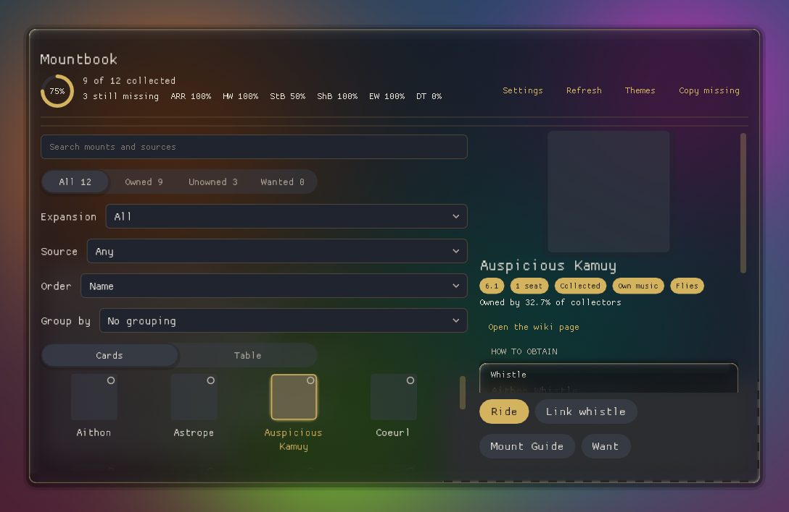
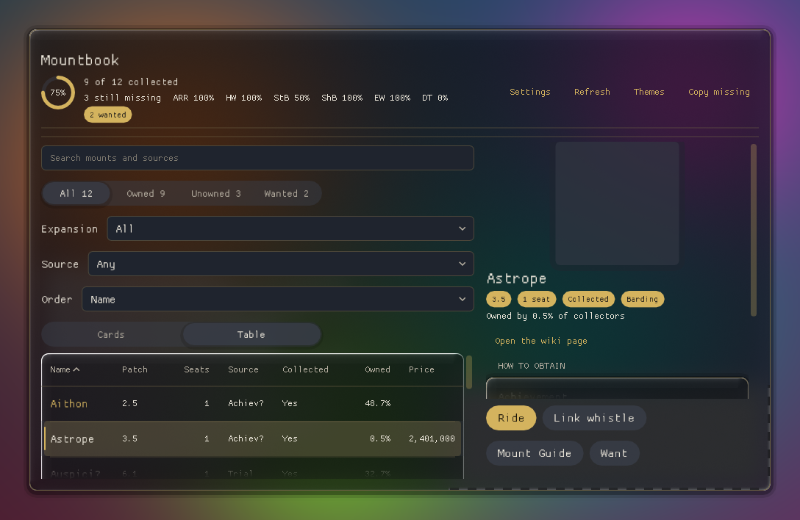
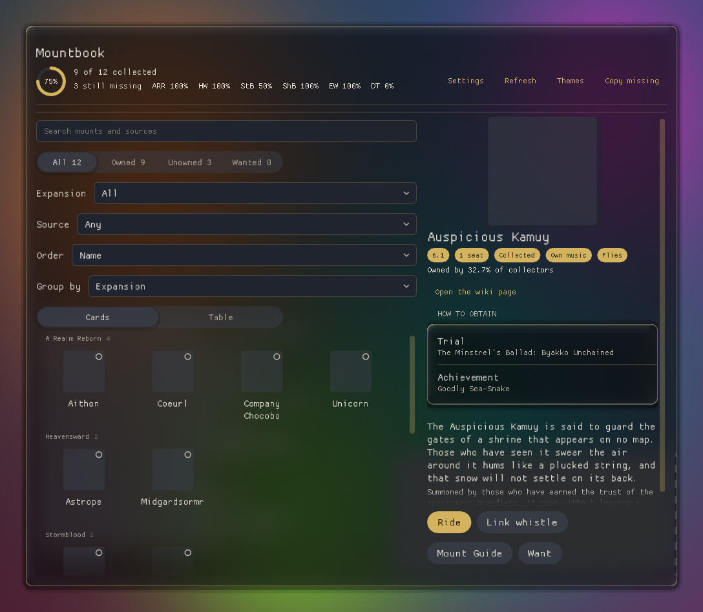
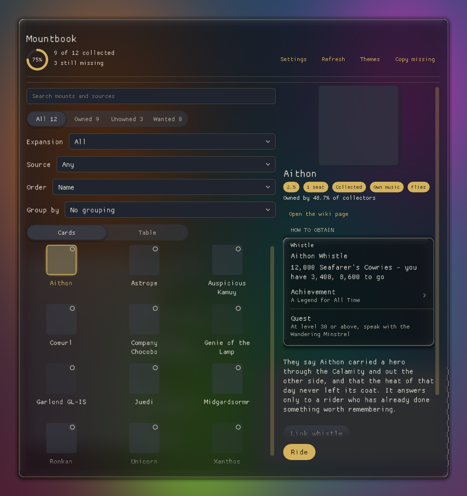

# Deepseek-Kingdom

A workshop **and** distributor for new Final Fantasy XIV **Dalamud** plugins: a rulebook, a starting
template, a deterministic gate, and the release automation that turns a plugin into something players
can install. A new plugin does not begin by re-deciding project layout, and it does not ship because
someone remembered to bump a version.

## Add the repository in game

Dalamud → `/xlsettings` → **Experimental** → **Custom Plugin Repositories**:

```
https://raw.githubusercontent.com/KazimeirzOdnowiciel/Deepseek-Kingdom/main/repo.json
```

Then install from `/xlplugins`. An empty index (`[]`) is a valid state and is what this repository
serves until the first plugin is promoted.

| Path | What it is |
| --- | --- |
| [`CONTRIBUTING.md`](CONTRIBUTING.md) | The rulebook. Every rule has an id (`N4`, `A2`, `T1`, `P4`) so a review finding cites one instead of paraphrasing. |
| [`AI-USAGE.md`](AI-USAGE.md) | The declared AI level (Copilot), the five human gates, and the limits. |
| [`templates/new-plugin/`](templates/new-plugin/TEMPLATE.md) | A compiling plugin, its unit-test project and its preview (golden-image) project, already conforming to the rulebook. |
| [`scripts/new-plugin.ps1`](scripts/new-plugin.ps1) | Starts a plugin from the template in one command: three projects, every token renamed, the golden re-rendered, the gate run. |
| [`scripts/check.ps1`](scripts/check.ps1) | The gate for one plugin: build, tests, format. JSON on the last line. |
| [`scripts/check-all.ps1`](scripts/check-all.ps1) | The same gate over every plugin in `src/` **and the template**. What CI runs. |
| [`build.ps1`](build.ps1) | Packages every listed plugin into `dist/` and rewrites `repo.json`. |
| `repo.json`, `dist/` | The published index and the zips it points at. |
| `icons/` | One `<InternalName>.png` per plugin (see [`icons/README.md`](icons/README.md)). |
| `docs/screenshots/` | Screenshots of the plugin windows, rendered from the golden images so they cannot drift from the code. |
| `.github/workflows/` | `ci.yml` gates pull requests; `release.yml` gates, packages and commits artifacts on a version bump. |
| `.editorconfig`, `Directory.Build.props` | The machine half of the rulebook: formatting, nullable, analyzers, warnings-as-errors. |

## In the workshop

**These are test plugins.** They exist to exercise the pipeline end to end — the template, the
three-way split, the golden gate, the review — not because either is a product. They are not
published, and either can be deleted or rewritten without notice.

Three plugins are built here, and **none is published**: being in `src/` does not list a plugin, and
nothing is promoted before it has run in the game (`P1`).

| Plugin | What it does | State |
| --- | --- | --- |
| [`src/Mountbook/`](src/Mountbook/Plugin.cs) | A collection book for every mount in the game: card grid or dense sortable table, search with operators, order (name, patch, seats, rarity, market price, "surprise me"), group by expansion/patch/source, a wanted list with JSON export and import, and a detail pane with the game's artwork, community rarity, token prices with your own progress, market prices on demand, and a "How to obtain" list whose rows open the wiki. | Gate green with **ten goldens**; the in-game checks are listed in the [Mountbook section](#mountbook) below. |
| [`src/TerritoryCard/`](src/TerritoryCard/Plugin.cs) | A card showing the current territory and the local Eorzea time, with a Copy ET button. | Gate green, 41 tests, **verified in game**: loads, the glass refracts, the zone resolves, `0` error lines, clean `/xldev` reload. |
| [`src/Sprintwatch/`](src/Sprintwatch/Plugin.cs) | A session stopwatch with Start/Stop/Lap/Reset, a lap table and 12/24-hour lap clocks. | Gate green, 26 tests. Not yet run in the game. |

All three were produced by the pipeline this repository exists for, which is the point of them.

## Mountbook

A collection book for all 369 mounts, built to answer one question: *what do I still need, and what does it
take to get it?*

| | |
| --- | --- |
|  |  |
| Cards with the artwork, wanted and new markers, and a detail pane. | The same list as a sortable table with a market price column. |
|  |  |
| Grouped by expansion, patch or acquire method. | "How to obtain", a token price with your progress, and rows that open the wiki. |

What it does, in the order a player meets it:

- **Find it.** Search names, lore, tooltips and source text, plus operators (`tradeable:y`, `music:n`,
  `barding:y`, `flying:y`, `seats:>=2`, `patch:>=6.1`, `owned:<1`). Ownership chips show their counts;
  the source and expansion filters narrow the same list.
- **Read it.** Cards or a dense table; order by name, patch, seats, rarity or market price, or "surprise
  me" for a seeded shuffle. Group by expansion, patch or acquire method.
- **Get it.** The detail pane carries the game's artwork, flavour text, community rarity ("owned by 0.4%
  of collectors"), the whistle's name, a token price with the player's own count, the cheapest listing on
  their data center when they ask for it, and a "How to obtain" list where each row that names a duty,
  quest or achievement opens its page.
- **Track it.** A wanted list that exports and imports as JSON, a "New" marker for what the collection
  gained in the last two weeks, per-expansion progress, and `/mountbook recent`, `/mountbook missing`,
  `/mountbook wanted` in chat.

**What is verified where.** Unit tests and goldens cover the pure logic and every screen; the in-game runs
cover loading, the catalog (369 mounts, 136 collected), Ride, Link whistle, Mount Guide, copy-missing, the
filters and chips, the table, `tradeable:` / `barding:` / `flying:` searches, wanted-list import and copy,
market prices ("73 prices read across 5 request(s)", cheapest first), token progress ("12,000 Seafarer's
Cowries - you have 0, 12,000 to go") and a source row opening its wiki page. The rest is marked as
unverified in `STATE.md` rather than claimed here.

**What it touches.** It reads the `Mount`, `MountTransient` and `Item` sheets and your unlocked-mount
state; it writes nothing to the game. Its one network call is the market price you ask for (Universalis,
for your data center), and the data it ships with is a snapshot of ffxivcollect's obtain data.

## How a plugin gets built here

One lead and three implementers. The lead writes the spec, splits the work into three disjoint file
sets with a contract between them, scaffolds from the template, then integrates, reviews its own diff
and runs the gate. The three own `Services/` (pure, Dalamud-free logic), `Views/` (drawing plus the
headless preview screen) and the wiring (`Plugin.cs`, `Configuration.cs`, projects, tests).

They never build at the same time — one shared `obj/` — and the lead builds once at integration. Two
seams only the lead can see have already been found this way: a public `[Theory]` cannot take an
`internal` enum parameter, and a part's tests can call an overload that does not exist.

The shape is written down in the `dalamud-new-plugin` skill; `references/pipeline.js` is the same
shape as a script, for runs that must happen unattended.

## Start a plugin

```powershell
powershell -NoProfile -ExecutionPolicy Bypass -File .\scripts\new-plugin.ps1 -Name FooBar
```

One command: it copies the three projects, renames every token the template carries, re-renders the
golden and runs the gate, printing
`{"plugin":"FooBar","golden":"rendered","gate":"passed","ok":true}`. The name becomes the
**InternalName** (config folder, log tag, plugin identity), so pick it once and never change it after
release; the script rejects anything that is not a C# identifier. What it does not do: touch
`build.ps1` and commit — publishing stays a deliberate step.

## Check it

```powershell
powershell -NoProfile -ExecutionPolicy Bypass -File .\scripts\check.ps1 -Name FooBar
powershell -NoProfile -ExecutionPolicy Bypass -File .\scripts\check-all.ps1
```

The first prints `{"plugin":"FooBar","build":true,"tests":"passed","format":"clean","previews":"passed","ok":true}`
and exits 0 only when all four pass. The second does that for every plugin **and for the template**,
so a broken scaffold cannot land without something having built it. Formatting is enforced by
`dotnet format`, so never argue style in review — and always scope it to one project, or it will
reformat everything in the tree.

The gate proves a plugin **compiles, passes its unit tests, is formatted, and its window still renders
the same pixels**. It proves nothing about behaviour in the client. In-game behaviour is the human's
checklist.

## Publish it

A plugin ships only when it is listed in `$plugins` in [`build.ps1`](build.ps1). Being in `src/` is
not publishing.

1. Add `$plugins += @{ Folder = "FooBar"; Project = "FooBar.csproj" }` to [`build.ps1`](build.ps1)
   (one line per plugin — a one-element `@( item, )` literal is a PowerShell parse error).
2. Drop `icons/FooBar.png` (512×512).
3. Bump `<Version>` in the csproj — four parts, `0.1.0.0`. A three-part version fails the *install*,
   not the build (`P4`).
4. Run `./build.ps1`, commit `dist/` **and** `repo.json` together.

On `main`, `release.yml` does steps 4 for you, and commits the artifacts only when an
`AssemblyVersion` actually changed — so a push without a version bump cannot silently replace a
user's binaries.

## What the template gives you

A working plugin on [Glasswork](https://github.com/XeldarAlz/FFXIV-Glasswork) (MIT, API 15): real
refracting glass behind the pane, themed `Gw` widgets instead of stock ImGui controls, a `Look` that
restyles everything from one assignment, `IPluginConfiguration` with a `Migrate()`, a `WindowSystem`
with stable `###` window ids, a slash command whose help enumerates its subcommands, a `Views/` body
split from its `Windows/` shell so the preview can draw it, and a `Services/` folder whose contents the
test project compiles **by path** — so a Dalamud type in "pure" logic fails the test build rather than
relying on a reviewer to notice.

## Seeing the UI without the game

`src/<Name>.Previews` builds an `IPreviewScreen` that draws the main view with fixed sample data.
`glasswork-preview` renders it headless on WARP — its own Direct3D 11 device, real ImGui, your
Dalamud fonts — and compares it with `goldens/main.png`:

```powershell
dotnet tool restore
dotnet glasswork-preview --assembly "src/FooBar.Previews/bin/Release/FooBar.Previews.dll" --compare "src/FooBar.Previews/goldens" --warp
```

`scripts/check.ps1` runs that as step 4, so a UI regression fails the gate in CI and the renders plus
red-highlighted `.diff.png` files are uploaded as an artifact. Locally they land in
`artifacts/previews/<Name>`.

What it covers is layout, spacing, typography, control states and the card panel. What it cannot cover
is the glass itself, which only runs in the client — so "the pane stopped refracting" will not fail
the golden, but "the button moved onto the label" will.

## Status

- **This repository's own plugins are test plugins.** They are unpublished experiments that exist to
  prove the pipeline works; nothing here is offered as a product.
- **Template** — builds with 0 warnings under `TreatWarningsAsErrors`, 6 unit tests pass, `dotnet format` is clean and its golden compares byte-identical. It is gated in CI alongside the plugins, so a broken scaffold cannot land unnoticed. Changing one button label was verified to fail the gate (`previews: mismatch`, exit 1).
- **Gate** — `check.ps1` covers compile, tests, format and the UI golden. `check-all.ps1` runs it over every plugin **and** the template, and CI runs on changes to `src/`, `scripts/`, `templates/`, `dotnet-tools.json` and `build.ps1`.
- **Published** — nothing. `repo.json` is `[]`, `dist/` is empty, and neither plugin is in `build.ps1`'s `$plugins` list.
- **In the game** — TerritoryCard and Mountbook have run in the client; Sprintwatch has not. Mountbook's seven screens (main, empty, narrow, wanted, config, minimum, locked) are compared as goldens; every screen beyond `main` has already caught a regression the wide screen could not see (a title past the pane, a clipped action button, a wrapped combo cap, an overflowing path, and a disabled button breaking its row).

Not verified, and not verifiable here: anything else that needs the game running — whether a control
does what its label says under real load, and whether behaviour holds through a duty or a cutscene.

## Licence

MIT — see [`LICENSE`](LICENSE). Published packages carry `LICENSE` and
[`THIRD-PARTY-NOTICES.md`](THIRD-PARTY-NOTICES.md) inside the zip, because they bundle Glasswork's
MIT assemblies.
